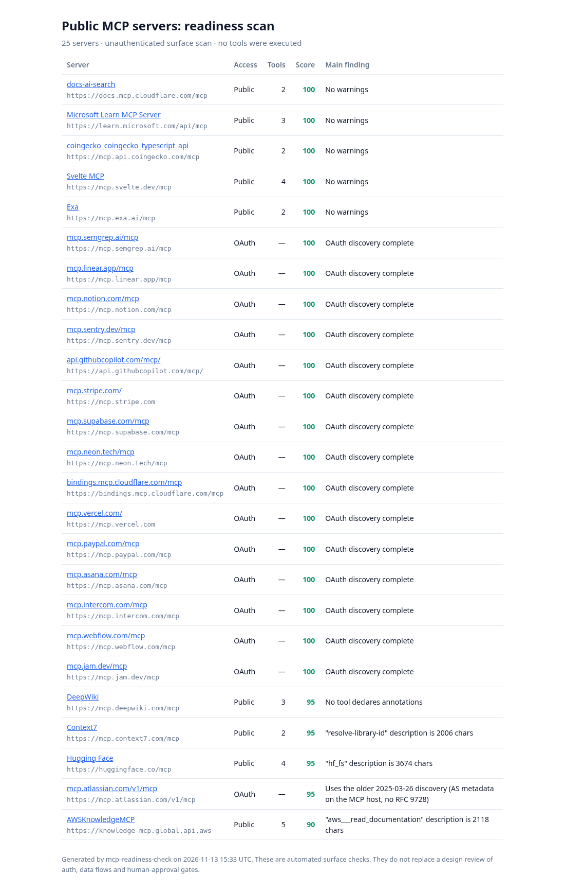

# mcp-readiness-check

**Live MCP readiness and context-cost scanning.** It connects to your running MCP server the way Claude, ChatGPT and Cursor do, then scores OAuth discovery, safety annotations, Origin/CORS, schemas, and the tokens your tool list costs on every agent turn. It is built on a 13 Nov 2026 scan of 15,067 live servers from the official MCP registry ([State of public MCP servers, Nov 2026](reports/state-of-mcp-2026-11.pdf)).

> **Is your MCP server ready for real agents?**

## CI quick start: badge and PR gate in 3 steps

Full guide with troubleshooting: https://mcp.pacerai.fit/docs/ci/

1. **Scan** your server free at https://mcp.pacerai.fit (no sign-up).
2. **Add the badge** to your README (swap in your URL):
   ```markdown
   [](https://mcp.pacerai.fit/s/your-server.example.com/mcp)
   ```
3. **Add the Action** as `.github/workflows/mcp-readiness.yml`:
   ```yaml
   name: MCP readiness
   on: [pull_request]
   jobs:
     mcp-readiness:
       runs-on: ubuntu-latest
       steps:
         - uses: Om3rr/mcp-readiness-check@v1
           id: mcp
           with:
             url: https://your-server.example.com/mcp
             fail-under: 80            # fail below this score (default 70, 0 never fails)
             max-context-tokens: 8000  # fail if tools/list costs more tokens per turn (default 0 = off)
         - run: echo "Score ${{ steps.mcp.outputs.score }}, ~${{ steps.mcp.outputs.context-tokens }} tokens per turn"
   ```

**Local server in CI:** start it in the job, wait for the port, then scan localhost:

```yaml
      - run: |
          PORT=8787 npm start &
          for i in $(seq 1 30); do curl -s -o /dev/null http://127.0.0.1:8787/mcp && break; sleep 1; done
      - uses: Om3rr/mcp-readiness-check@v1
        with:
          url: http://127.0.0.1:8787/mcp
          fail-under: 80
          max-context-tokens: 8000
```

| Input | Default | What it does |
|---|---|---|
| `url` | required | Streamable HTTP endpoint: public https URL or `http://127.0.0.1:PORT/mcp` |
| `fail-under` | `70` | Fail below this score (0-100); 0 never fails |
| `max-context-tokens` | `0` | Fail if the tool list costs more tokens per turn; 0 disables |
| `token` | `""` | Bearer token (from secrets) to scan tools behind login |
| `json-path` | `""` | Write the JSON report here |
| `api-key` | `""` | Optional license key; not needed for the free tier |

Outputs: `score`, `context-tokens`, `findings`, `mode`.

**Troubleshooting**
- *OAuth discovery fails:* on 401, send `WWW-Authenticate: Bearer resource_metadata="…/.well-known/oauth-protected-resource"`, serve RFC 9728 metadata with `authorization_servers`, and RFC 8414 metadata on the authorization server. Pass `token` to scan tools behind login.
- *Foreign Origin / CORS flagged:* validate `Origin` and return 403 for unknown origins; keep `Access-Control-Allow-Origin` to an allowlist. On localhost this is a fail (DNS rebinding).
- *Timeouts or connection refused:* each request waits up to 15 s. Wait for the server to start (loop above), bind to the port in `url`, and use the Streamable HTTP path, not SSE-only or stdio.
- *Token budget fails:* shorten tool descriptions and schemas, or set `max-context-tokens: 0` while you work on it.
- *First run too strict:* start with `fail-under: 0`, fix the top issues, then raise it.

## GitHub Action: MCP Readiness Scan (free tier, 50 runs/day per repo)

```yaml
- uses: Om3rr/mcp-readiness-check@v1
  with:
    url: http://127.0.0.1:8787/mcp   # start your server earlier in the job
    fail-under: 80
    max-context-tokens: 8000
```

Outputs: `score`, `context-tokens`, `findings`, `mode`. Listing text: [MARKETPLACE.md](MARKETPLACE.md).

**Badge** (links to your server's own public report page): `[](https://mcp.pacerai.fit/s/your-server/mcp)`
**Hosted scan service and `scan_mcp_server` remote tool:** https://mcp.pacerai.fit — see [Use from your agent (MCP)](#use-from-your-agent-mcp). The Worker also stays at https://mcp-readiness.omer20sh.workers.dev for the API, badges, and GitHub Action. See [worker/](worker/README.md)

**Free tier:** score gate, context-token budget, top 3 issues per run, 50 runs/day per repo, plus this CLI (unlimited, local).

Heavy tool list? See [how to reduce tool-list token cost](https://mcp.pacerai.fit/blog/reduce-mcp-tool-list-token-cost/) and the [MCP server token cost ranking](https://mcp.pacerai.fit/token-cost/).

The CLI's `--json` (and `--json-out FILE`, or the Action's `json-path` input) includes `target` and the raw `tools` list, so your own tooling can work from the report without re-connecting to your server.

## CLI

A zero-dependency CLI (Node 18+) that scores an MCP server's **production readiness** in about a second and writes a Markdown report you can hand to a team.

```bash
node bin/mcp-readiness-check.js https://your-server.example/mcp --token $TOKEN   # Streamable HTTP
node bin/mcp-readiness-check.js --stdio node path/to/server.js                    # stdio servers
node bin/mcp-readiness-check.js <url> --json                                      # machine-readable, exit 1 on any ❌
node bin/mcp-readiness-check.js <url> --html report.html                          # self-contained HTML report (light/dark)
node bin/mcp-readiness-check.js --batch servers.txt --out reports/                # scan many, writes reports/index.html
npm test
```

## What it checks

| Area | Checks |
|---|---|
| **Tool poisoning** | Instructions aimed at the model inside tool metadata: "ignore previous instructions", `<IMPORTANT>` tags, "don't tell the user", references to `.ssh` / `.env` / API keys, invisible or bidi unicode, long base64 blobs |
| **Human-in-the-loop** | State-changing tools (`delete_*`, `send_*`, `pay_*`, `approve_*`, `exec`…) without `readOnlyHint` / `destructiveHint` annotations; servers with no annotations at all |
| **Schemas** | `inputSchema` missing or not `type: object`, untyped args, no `required` list, duplicate or non-portable tool names, vague or bloated descriptions, too many tools |
| **Transport security** | Plain HTTP to a remote host, **Origin not validated** (the spec's DNS-rebinding MUST), wildcard CORS, `tools/list` or tool calls that work with no credentials |
| **OAuth (2025-06-18)** | For servers that return 401: `WWW-Authenticate` with `resource_metadata`, RFC 9728 protected-resource metadata, RFC 8414 authorization-server metadata, PKCE S256, dynamic client registration, and detection of the legacy 2025-03-26 flow |
| **Prompts and sessions** | Poisoning in `prompts/list` metadata; guessable `Mcp-Session-Id`; stack traces or file paths leaking in errors; generic tool names that collide across servers; missing tool titles; old protocol versions |
| **JSON-RPC hygiene** | `-32601` for unknown methods, no 5xx on unknown tools, `protocolVersion`, `serverInfo`, server `instructions` |

Scoring: start at 100, −15 per ❌, −5 per ⚠️. It is a surface scan, not a substitute for an architecture review of auth, data flows and approval gates.


## Use from your agent (MCP)

The hosted scanner is also a free, live remote MCP server at `https://mcp.pacerai.fit/mcp` (Streamable HTTP, no license key). Add that URL as a remote server in your agent, then call the `scan_mcp_server` tool with the `https` URL of an MCP server you own or are authorized to test.

```json
{
  "mcpServers": {
    "mcp-readiness": {
      "type": "streamable-http",
      "url": "https://mcp.pacerai.fit/mcp"
    }
  }
}
```

The tool returns a readiness score, an estimate of tokens per turn for the tool list, key findings, and a link to the full results page. Calls are rate-limited (10 per minute and 100 per day per client). This is a surface scan, not a security audit. There is no paid or Pro gate on this tool.

The same endpoint is also served at `https://mcp-readiness.omer20sh.workers.dev/mcp`.

### Origin policy

`POST /mcp` follows the MCP Streamable HTTP rule that servers MUST validate `Origin`:

- Requests with **no `Origin` header** (server-side agents and CLIs) are allowed.
- Browser requests are allowed only from the site's own origins, `https://mcp.pacerai.fit` and `https://mcp-readiness.omer20sh.workers.dev`, plus `http`/`https` `localhost`, `127.0.0.1`, and `::1` (any port) for local inspectors such as MCP Inspector.
- Any other `Origin` receives HTTP 403 with a JSON-RPC error (`-32000`, "Origin not allowed").
- Allowed browser responses include `Access-Control-Allow-Origin` set to that origin (not `*`), plus the same `Access-Control-Allow-Methods` and `Access-Control-Allow-Headers` as `OPTIONS`. The server is stateless and does not issue `Mcp-Session-Id`. `GET /mcp` remains 405.

## Examples



* **[Scan of 25 public MCP servers](examples/public-scan-2026-11-13.md)** ([HTML](examples/public-scan/index.html)), covering Stripe, Notion, Linear, Sentry, GitHub, Supabase, Vercel, PayPal, Cloudflare, Microsoft Learn, AWS Knowledge, Hugging Face, Context7, DeepWiki and more. The big vendors are in good shape. The gaps are bloated tool descriptions, missing annotations, and one legacy OAuth flow.
* **Before/after on our own gateway:** [agent-commerce-mvp v0.3](examples/agent-commerce-v0.3.md) ([HTML](examples/agent-commerce-v0.3.html)) scored **60/100**: it accepted foreign Origins, sent wildcard CORS, and had no annotations on its write tools. After the fixes, [v0.4](examples/agent-commerce-v0.4.md) ([HTML](examples/agent-commerce-v0.4.html)) scores **100/100**.

**Media** (`docs/media`): [CLI run (GIF)](docs/media/cli.gif) / [MP4](docs/media/cli.mp4) · [HTML reports walkthrough (MP4)](docs/media/html-reports-walkthrough.mp4) · screenshots: [scan light](docs/media/public-scan-light.png), [scan dark](docs/media/public-scan-dark.png), [report before](docs/media/report-before-light.png), [report after](docs/media/report-after-light.png)

## License

[MIT](LICENSE) © 2026 Omer Shacham
