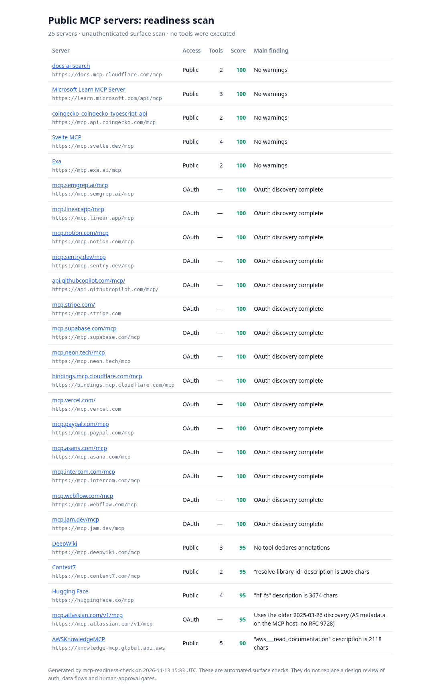

# mcp-readiness-check

A zero-dependency CLI (Node 18+) that scores an MCP server's **production readiness** in about a second and writes a Markdown report you can hand to a team.

```bash
node bin/mcp-readiness-check.js https://your-server.example/mcp --token $TOKEN   # Streamable HTTP
node bin/mcp-readiness-check.js --stdio node path/to/server.js                    # stdio servers
node bin/mcp-readiness-check.js <url> --json                                      # machine-readable, exit 1 on any ❌
node bin/mcp-readiness-check.js <url> --html report.html                          # self-contained HTML report (light/dark)
node bin/mcp-readiness-check.js --batch servers.txt --out reports/                # scan many, writes reports/index.html
npm test
```

## What it checks

| Area | Checks |
|---|---|
| **Tool poisoning** | Instructions aimed at the model inside tool metadata: "ignore previous instructions", `<IMPORTANT>` tags, "don't tell the user", references to `.ssh` / `.env` / API keys, invisible or bidi unicode, long base64 blobs |
| **Human-in-the-loop** | State-changing tools (`delete_*`, `send_*`, `pay_*`, `approve_*`, `exec`…) without `readOnlyHint` / `destructiveHint` annotations; servers with no annotations at all |
| **Schemas** | `inputSchema` missing or not `type: object`, untyped args, no `required` list, duplicate or non-portable tool names, vague or bloated descriptions, too many tools |
| **Transport security** | Plain HTTP to a remote host, **Origin not validated** (the spec's DNS-rebinding MUST), wildcard CORS, `tools/list` or tool calls that work with no credentials |
| **OAuth (2025-06-18)** | For servers that return 401: `WWW-Authenticate` with `resource_metadata`, RFC 9728 protected-resource metadata, RFC 8414 authorization-server metadata, PKCE S256, dynamic client registration, and detection of the legacy 2025-03-26 flow |
| **Prompts and sessions** | Poisoning in `prompts/list` metadata; guessable `Mcp-Session-Id`; stack traces or file paths leaking in errors; generic tool names that collide across servers; missing tool titles; old protocol versions |
| **JSON-RPC hygiene** | `-32601` for unknown methods, no 5xx on unknown tools, `protocolVersion`, `serverInfo`, server `instructions` |

Scoring: start at 100, −15 per ❌, −5 per ⚠️. It is a surface scan, not a substitute for an architecture review of auth, data flows and approval gates. That review is the paid offer below.

## Examples



* **[Scan of 25 public MCP servers](examples/public-scan-2026-11-13.md)** ([HTML](examples/public-scan/index.html)), covering Stripe, Notion, Linear, Sentry, GitHub, Supabase, Vercel, PayPal, Cloudflare, Microsoft Learn, AWS Knowledge, Hugging Face, Context7, DeepWiki and more. The big vendors are in good shape. The gaps are bloated tool descriptions, missing annotations, and one legacy OAuth flow.
* **Before/after on our own gateway:** [agent-commerce-mvp v0.3](examples/agent-commerce-v0.3.md) ([HTML](examples/agent-commerce-v0.3.html)) scored **60/100**: it accepted foreign Origins, sent wildcard CORS, and had no annotations on its write tools. After the fixes, [v0.4](examples/agent-commerce-v0.4.md) ([HTML](examples/agent-commerce-v0.4.html)) scores **100/100**.

**Media** (`docs/media`): [CLI run (GIF)](docs/media/cli.gif) / [MP4](docs/media/cli.mp4) · [HTML reports walkthrough (MP4)](docs/media/html-reports-walkthrough.mp4) · screenshots: [scan light](docs/media/public-scan-light.png), [scan dark](docs/media/public-scan-dark.png), [report before](docs/media/report-before-light.png), [report after](docs/media/report-after-light.png)

## Turning it into work (draft, unpublished)

**MCP Readiness Review, fixed fee.** Run the scan, then a principal architect reviews auth (OAuth 2.1 / scoped tokens), tool permission design, approval gates, audit logging, prompt-injection paths and multi-tenancy, and delivers a ranked fix list plus a 60-minute walkthrough. Entry tier for the larger *AI agent / MCP platform architecture review*.
